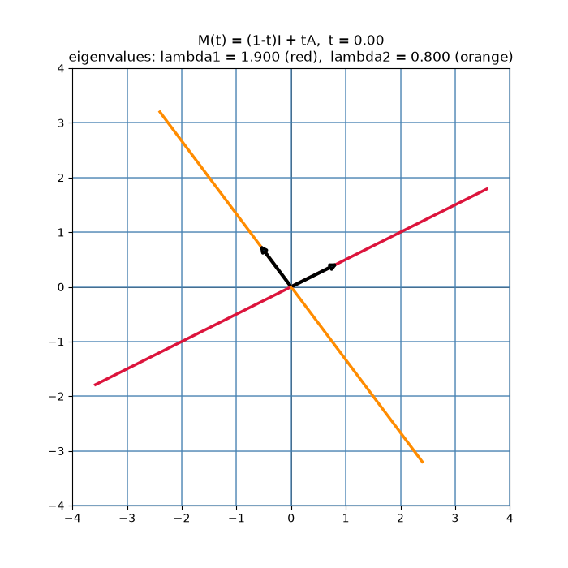
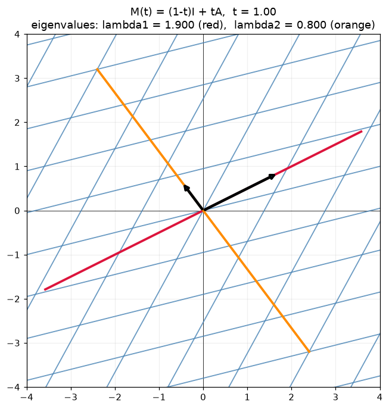
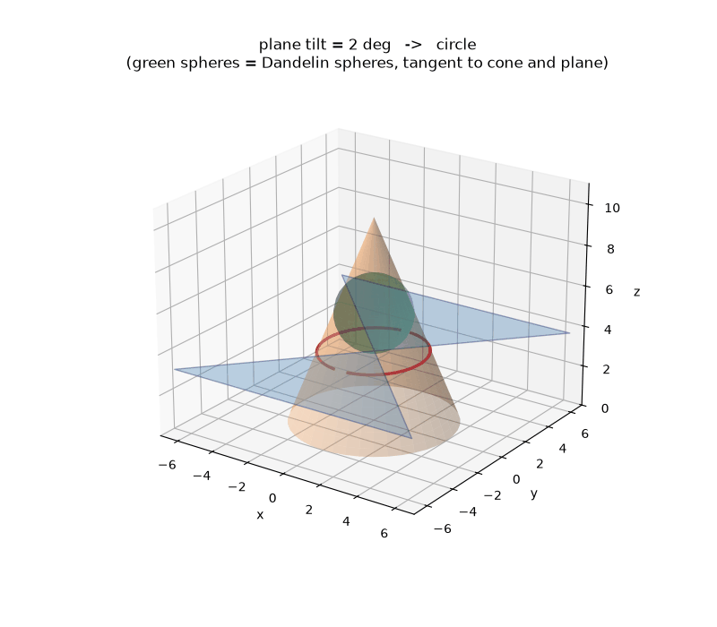
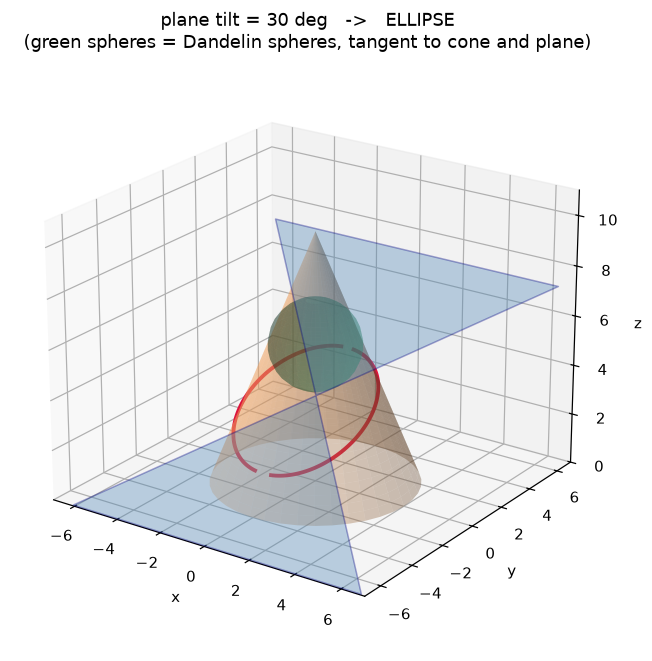

# Math — Interactive Physical Model Animations

Renderings and animations for interactive 3D-printable math teaching models.

## Eigenvector grid deformation

A square grid deforming under a linear map `A`. The two colored lines are the
eigenvectors — the only directions that do not rotate. The arrows show the
eigenvalue stretch factors (red: λ = 1.9, orange: λ = 0.8).



Final frame:



### Reproduce

```bash
pip install numpy matplotlib pillow
python eigen_grid.py   # writes eigen_grid.gif and eigen_grid_final.png
```

### Physical model mapping

- Blue grid → deformable lattice on a sliding-pin frame (3D printed)
- Red/orange lines → removable eigen-direction dowels that stay fixed while the grid shears
- Arrows → stretch factors read off as eigenvalues

## Conic-section slicer

Animation of a plane tilting through a cone: circle -> ellipse -> parabola ->
hyperbola, with the green Dandelin spheres (tangent to both cone and plane)
shown at each tilt. The spheres are what make the focal property visible.



Static frame (30 deg tilt, ellipse):



### Reproduce

```bash
pip install numpy matplotlib pillow
python conic_slicer.py   # writes conic_slicer.gif and conic_slicer_ellipse.png
```

## 3D-printable parts (`stl/`)

Generated by `gen_stl.py` (requires `trimesh`, `manifold3d`). All dimensions in mm.

| File | Part | Notes |
|---|---|---|
| `stl/base_plate.stl` | 142x142x5 mm plate with 9x9 hole grid (4.4 mm holes, 14 mm spacing) | PLA, ~30 min |
| `stl/flex_grid.stl` | 9x9 node lattice, thin 2 mm bars act as living hinges so it shears by hand | Print flat; TPU or thin PLA flexes best |
| `stl/eigen_dowels.stl` | Two 4 mm dowels, 170 mm long with cone tips | Paint one red, one orange to match the animation |

### Demo
1. Lay the flex grid on the base plate.
2. Drag a corner to shear/stretch the grid (like the GIF).
3. Lay the dowels along the directions that did not rotate — the eigenvectors.
4. Compare their stretch to lambda = 1.9 / lambda = 0.8 from the animation.
